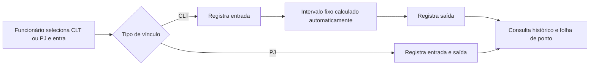

<p align="center">
  
</p>

<h1 align="center">KairoPont</h1>
<p align="center"><strong>Controle de jornada da Kairo Automações</strong></p>

<p align="center">
  <a href="https://oc-mateus.github.io/KairoPont/">Abrir aplicação</a> ·
  <a href="https://github.com/oc-mateus/KairoPont">Ver repositório</a>
</p>

---

O KairoPont organiza o registro de jornada, a consulta de históricos e a gestão de funcionários CLT e PJ. A aplicação web fica no GitHub Pages; autenticação, banco de dados e arquivos usam o Supabase. O [Guia do Projeto](docs/GUIA_DO_PROJETO.md) reúne os fluxos, regras de negócio, estrutura técnica e procedimentos de operação. A preparação para pilotos comerciais está documentada em [Comercialização e operação](docs/COMERCIALIZACAO.md), e os controles e testes de segurança em [Segurança](docs/SEGURANCA.md).

A revisão de lançamento está no [checklist do site](docs/CHECKLIST_LANCAMENTO.md): páginas públicas com metadados próprios, contato, confirmação, 404, sitemap, ícones e imagens otimizadas. O responsável pelo projeto é **Mateus de Campos Oliveira**, pessoa física. O site permanece sem Analytics ou rastreamento de visitantes. A [preparação dos pedidos ao INPI](docs/REGISTROS_INPI.md) não representa registro concedido; a adequação trabalhista foi adiada pelo responsável.

## Como funciona



O Supabase valida o tipo de vínculo e a sequência das marcações e grava os horários oficiais no servidor, no fuso de São Paulo. Funcionários PJ registram entrada e saída e acompanham o total de horas trabalhadas. Funcionários CLT usam o almoço fixo nos dias úteis; em dias sem almoço previsto, jornadas acima de seis horas exigem uma pausa marcada de pelo menos uma hora antes da saída. O funcionário consulta os próprios registros e pode exportar o histórico.

### Recursos

A entrada e a saída são salvas no aparelho enquanto o navegador busca a localização para funcionários CLT e PJ. Com permissão, o app aceita uma leitura recente do aparelho e usa a alta precisão para melhorar resultados aproximados. A busca termina ao obter uma posição com precisão de até 100 m ou ao atingir o limite de 40 segundos. Se houver uma leitura aproximada, o app mantém a melhor posição recebida. O servidor vincula as coordenadas e a precisão à marcação correspondente. Se a captura falhar, o sistema guarda a indicação da falha. O administrador consulta a localização junto de cada horário em **Funcionários** e abre o local no mapa. A opção **Incluir localizações no relatório**, desmarcada por padrão, inclui as coordenadas na exportação para PDF e Excel. Registros antigos ou inseridos manualmente não recebem coordenadas retroativas. Horários corrigidos deixam de exibir a localização da marcação original.

**Modo offline.** Entre na conta com conexão neste aparelho para preparar o acesso offline. A tela de ponto guarda as marcações no navegador e mostra quais ainda aguardam envio. Quando a internet volta, o app envia a fila automaticamente enquanto está aberto. Se estiver fechado, o envio retoma ao reabri-lo. A sincronização conserva a hora indicada pelo aparelho e registra na auditoria a hora de recebimento pelo servidor. O servidor valida a sequência e evita duplicidades. Conflitos ficam visíveis na tela para nova tentativa. Limpar os dados do site pode apagar as marcações que ainda estão no aparelho.

Antes de publicar o frontend, aplique as migrações de localização e sincronização, incluindo `20261112113641_async_punch_location.sql` e `20261112115139_offline_punch_sync.sql`. A captura e o modo offline usam HTTPS (ou localhost em desenvolvimento). As coordenadas são informadas pelo dispositivo.

A tela de ponto mostra um aviso quando o descanso desde a última saída é inferior a 11 horas. Antes da entrada, ela mostra o horário em que as 11 horas serão completadas. Se a pessoa registrar uma entrada antes desse horário, a tela mostra o descanso efetivo.

| Funcionário | Administrador |
| --- | --- |
| Escolher CLT ou PJ no login e registrar o próprio ponto | Acompanhar faltas, atrasos e horas extras de CLT |
| Consultar o próprio histórico | Gerenciar perfis e status de funcionários |
| Exportar folha de ponto em PDF ou Excel | Pesquisar funcionários por nome, CPF e cargo e ordenar alfabeticamente |
| Solicitar redefinição de senha pela tela de login | Distinguir CLT/PJ e ver resumo de horas PJ e extras CLT |

Na seção **Jornada PJ** da visão geral, o administrador acompanha as horas da equipe e de cada funcionário com o mesmo filtro de período dos gráficos CLT. O cálculo das jornadas PJ concluídas desconta uma hora de almoço quando o tempo entre entrada e saída passa de seis horas. Se houver uma pausa registrada de uma hora ou mais, ela já cobre o desconto.

O painel de frequência filtra mês atual, mês/ano específico, últimos seis meses ou último ano; mostra os gráficos gerais primeiro e permite selecionar um funcionário CLT para ver os mesmos indicadores no mesmo período. Quando um mês específico não tem registros CLT, o painel informa que não há dados para aquele período. A folha de ponto identifica o vínculo; CLT apresenta o horário de trabalho e intervalo fixo ou marcado, enquanto PJ apresenta entrada, saída e horas computadas. O cálculo de atrasos compara a marcação com o início mais próximo entre os horários habituais do funcionário, arredondados à hora cheia; uma entrada às 13h, por exemplo, fica associada ao horário das 14h quando esse for o mais próximo. O cadastro CLT permite vários horários habituais: 06h–15h (almoço 12h–13h), 08h–17h (almoço 12h–13h) e 14h–22h52 (almoço 18h–19h). A jornada prevista é de 8h nos dias úteis, 4h aos sábados sem intervalo fixo e folga aos domingos. A ficha, o histórico e os PDFs apresentam esses horários habituais.

A interface mantém os mesmos componentes e espaçamentos nos temas claro e escuro, variando a paleta de cores. O botão de tema fica acessível no cabeçalho sem exigir rolagem horizontal. A navegação e os controles são responsivos para uso equivalente em celular e computador; ícones seguem o estilo do menu, sem emojis, e as páginas evitam títulos duplicados.

Na ficha do funcionário, **Editar cadastro** permite alterar nome, cargo, vínculo CLT/PJ, admissão e horários habituais, com salvamento conjunto e auditoria dos valores anteriores e novos. A opção “Contabilizar atrasos” foi retirada do formulário. Administradores também podem corrigir marcações de ponto com uma observação obrigatória, registrada na auditoria junto dos valores alterados. O período administrativo de correção e o fluxo para ajustes históricos são descritos no [Guia do Projeto](docs/GUIA_DO_PROJETO.md).

Funcionários CLT podem enviar e consultar documentos autorizados e acessar férias. Essas áreas não são exibidas para contas PJ, que usam o ponto apenas para registrar e acompanhar as horas trabalhadas. Na administração, a seção de férias da ficha também é exclusiva para CLT.

Na tela de login, administradores são encaminhados diretamente ao Painel Admin; funcionários CLT e PJ seguem para Registrar Ponto. A recuperação de senha funciona para os três tipos de conta e direciona o usuário à página para cadastrar uma nova senha.

O cadastro cria perfis de funcionário. A atribuição do papel de administrador é feita de forma controlada no banco, nunca pelo frontend.

## Privacidade e situação atual

- As políticas RLS limitam funcionários aos próprios dados; ações administrativas exigem perfil de administrador.
- O bucket `documentos` é privado. O bucket de fotos de perfil é público para exibir avatares.
- A tela e o servidor validam os tipos e os limites de arquivo: documentos de até 10 MB e fotos de até 5 MB. A migração de segurança aplica essas restrições; `npm run configure:storage` permite reaplicá-las. Forneça `SUPABASE_SERVICE_ROLE_KEY` apenas no ambiente local seguro do terminal.
- Convites e e-mails de férias têm cotas persistentes por administrador e por projeto, com bloqueio antes de chamar os provedores. Perfil e notificações permitem alterar somente os campos autorizados no banco.
- O acesso é feito com e-mail e senha, com seleção do vínculo CLT/PJ validada contra o cadastro do funcionário. Administradores podem usar qualquer opção. O CPF é solicitado no cadastro e usado para identificar o funcionário, não para entrar.

O site está publicado. A URL padrão do Supabase Auth e o endereço permitido para redefinição de senha usam `https://oc-mateus.github.io/KairoPont/` e `https://oc-mateus.github.io/KairoPont/definir-senha`. Antes do uso operacional, revise as credenciais da conta administrativa de teste e confirme a entrega de e-mails do Auth. Os limites e tipos do Storage foram aplicados ao ambiente atual em 8 de novembro de 2026.

## Desenvolvimento local

### Suporte

A central de ajuda em `/suporte` reúne orientações públicas e abre um chamado ao clicar em **Buscar orientação**. Somente contas com **Acesso ao suporte**, sendo administradoras ou não, consultam os pedidos em **Atendimentos**. A resposta é por e-mail, com destinatário, protocolo e problema completo preenchidos no rascunho; no portal o operador acompanha e atualiza o status. Administradores concedem o acesso em **Funcionários → Editar cadastro**. O contato de suporte é **mcoliveira@kairoautomacoes.com.br**; os avisos automáticos dependem da chave Resend e de um remetente verificado. A IA permanece desligada. Consulte [Suporte](docs/SUPORTE.md) para configuração, limites e testes.

Requisitos: Node.js 18 ou superior, npm e acesso ao Supabase `KairoPont`.

```bash
npm install
cp .env.example .env
npm run dev
```

Execute `npm test` para rodar os testes automatizados de cálculos de jornada, datas, escalas, CPF e validação das requisições. `npm run test:edge` verifica autorização, cotas e efeitos dos serviços com provedores simulados. `npm run check:edge` valida os tipos das funções. Os testes de permissões e RLS estão em `supabase/tests/security.sql` e desfazem todos os dados de teste ao terminar.

Preencha no `.env` local `VITE_SUPABASE_URL` e `VITE_SUPABASE_ANON_KEY` com os valores públicos apropriados ao cliente. Não envie `.env`, chaves privilegiadas, senhas ou tokens ao GitHub.

## Banco e publicação

As migrações devem ser aplicadas na ordem em que estão nomeadas em [`supabase/migrations`](supabase/migrations). O workflow [Publicar no GitHub Pages](.github/workflows/pages.yml) constrói e publica a branch `main`. As variáveis de build são configuradas no GitHub em **Settings → Secrets and variables → Actions → Variables**.

As instruções de configuração estão descritas nas migrações SQL, no workflow e nas variáveis do repositório.
